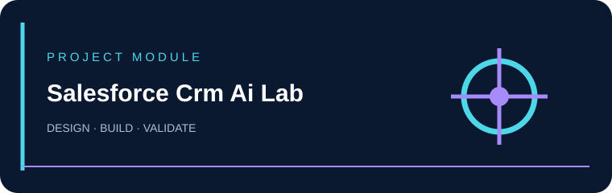

<div align="center">



**INDEPENDENT ENGINEERING PORTFOLIO · SALESFORCE CRM AI LAB**

[GitHub Profile](https://github.com/sghatge) · [Portfolio](https://sghatge.github.io/adobe-campaign-v8-governance/)

</div>

---

# Salesforce CRM Intelligence Lab

An interactive, hands-on Salesforce CRM learning lab built with Streamlit and synthetic customer records.

> **Educational simulator only:** no Salesforce org, Data Cloud or Agentforce tenant is connected. The app does not write CRM records, create Tasks, send messages or execute agent actions.

## Explore the lab
- **CRM Data Model:** inspect synthetic Accounts, Contacts, Leads, Opportunities, Cases and Campaigns, plus relationship concepts.
- **Customer 360:** view a consolidated synthetic contact, account, opportunity and service context.
- **Lead Management:** calculate an illustrative lead score, apply qualification and duplicate checks, and create session-only sample Leads.
- **Flow Simulator:** configure a record-triggered decision and evaluate it against a synthetic record.
- **Service & Cases:** inspect case queues, priority and sample SLA risk.
- **CRM Analytics:** explore opportunity pipeline, weighted pipeline and campaign response data; export CSV.
- **Governance & AI:** run a governance checklist and evaluate consent plus human approval for a proposed AI action.
- **AJO Integration:** preview and download a synthetic journey outcome and proposed Salesforce Task payload.

## Run locally
```bash
python -m venv .venv
pip install -r requirements.txt
streamlit run app.py
```

## Deploy for free
Use Streamlit Community Cloud:
- Repository: `sghatge/salesforce-crm-ai-lab`
- Branch: `main`
- Main file: `app.py`

No Vercel, paid hosting or hosted database is required.

## Learning boundaries
- Records and analytics are synthetic and reset with the app session.
- Lead scoring weights, thresholds and SLA rules are illustrative.
- Flow and AI actions are simulations only.
- Real integrations require a Salesforce org, OAuth, least-privilege permissions, field ownership, idempotency, error handling, security review and formal approval.
- Validate product features, licensing and org-specific configuration against current Salesforce documentation and your target org.

## Portfolio outcome
Demonstrates CRM data modelling, customer context, lead qualification, Flow logic, service operations, pipeline analytics, consent controls, AI governance and a closed-loop AJO-to-Salesforce integration pattern.
